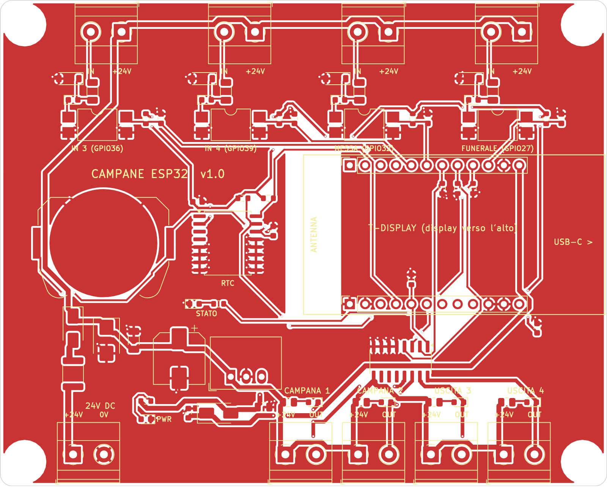
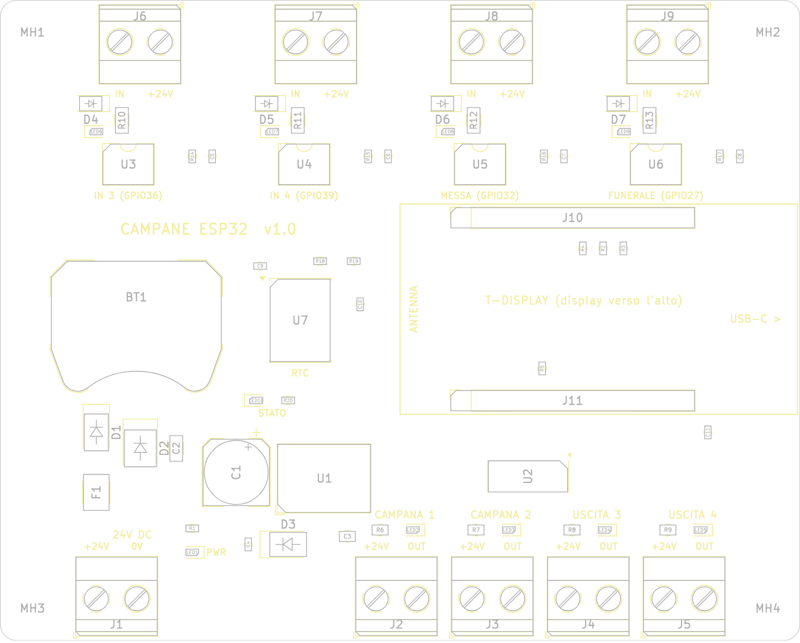

# Scheda base campane v1.0 (T-Display + 24 V)

Circuito stampato 100 × 80 mm su cui si innesta il **LilyGO T-Display ESP32**. La scheda:

- si alimenta a **24 VDC**, con fusibile ripristinabile, protezione dall'inversione di polarità e soppressore di picchi (TVS); un convertitore DC-DC TRACO ricava i 5 V;
- pilota **4 uscite a 24 V** tramite ULN2003: 2 campane più 2 di riserva, ciascuna con LED. Le uscite sono **spente** quando l'ESP32 è spento, in reset o in programmazione;
- legge **4 ingressi optoisolati a 24 V**: FUNERALE, MESSA e 2 di riserva, ciascuno con LED;
- ha l'**orologio DS3231 integrato** con batteria tampone CR2032;
- ha uno **zoccolo per il T-Display** con l'USB-C sul bordo, per programmarlo senza smontarlo, e la zona dell'antenna WiFi senza rame.

Sulla scheda arrivano solo 24 V: **niente 230 V**. I 230 V restano nel quadro elettrico.

| Lato componenti | Montaggio |
|---|---|
|  |  |

Schema elettrico: [`docs/schema-elettrico.pdf`](docs/schema-elettrico.pdf). Controllo DRC: [`docs/drc-report.txt`](docs/drc-report.txt) (0 errori, 0 collegamenti mancanti).

## File

| File | A cosa serve |
|---|---|
| `produzione/scheda-campane-gerber-jlcpcb.zip` | Gerber + forature, da caricare su JLCPCB |
| `produzione/scheda-campane-BOM-jlcpcb.csv` | Distinta materiali con i codici LCSC |
| `produzione/scheda-campane-CPL-jlcpcb.csv` | Posizione e rotazione dei componenti per il montaggio |
| `scheda-campane.kicad_pro/.kicad_pcb/.kicad_sch` | Progetto KiCad (si apre con KiCad 7 o successivi) |
| `tools/` | Script che rigenerano tutto (vedi in fondo) |

## Ordinare su JLCPCB

1. Su jlcpcb.com scegli **Order now** e carica lo zip dei Gerber. Lascia le impostazioni standard: 2 strati, FR-4, 1,6 mm, rame 1 oz. Quantità minima: 5 schede.
2. Attiva **PCB Assembly**, lato **Top**, tipo **Standard**. Lo Standard serve perché ci sono componenti a foro passante: morsetti, connettori del T-Display e convertitore DC-DC. Scegli quante schede montare (minimo 2).
3. Carica la **BOM** e il **CPL**. JLCPCB abbina i componenti tramite la colonna `LCSC Part #`.
4. **Controlla l'anteprima del montaggio**, componente per componente. Per alcuni package lo zero di rotazione di JLCPCB è diverso da quello di KiCad. Se un componente appare ruotato, correggilo nell'anteprima con il tasto di rotazione. Verifica in particolare:
   - **D1, D3** (SS34), **D2** (SMBJ33A), **D4–D7** (1N4148W): la banda del catodo deve coincidere con la banda disegnata sulla serigrafia;
   - **LED1–LED10**: catodo verso il segno della serigrafia;
   - **C1** (elettrolitico): il "+" verso il segno "+" della serigrafia;
   - **U2** (ULN2003), **U7** (DS3231), **U3–U6** (optoisolatori): il pallino del pin 1 sul segno del pin 1;
   - **BT1** (portabatteria CR2032).
5. La **batteria CR2032** non viene montata da JLCPCB: va comprata a parte e inserita.

Prima di ordinare, stampa `docs/scheda-montaggio.png` in **scala 1:1** (100 × 80 mm) e appoggia il T-Display sui due connettori, per controllare che le misure coincidano.

## Collegamenti nel quadro

```
Alimentatore 24 VDC ──► J1 "+24V" / "0V"

USCITE (J2..J5)                      RELÈ D'INTERFACCIA 24 VDC (es. Finder 38.51)
  morsetto "+24V" ─────────────────► A1 (+)
  morsetto "OUT"  ─────────────────► A2 (−)
                                      11 (COM) ◄── L 230 V (dopo il fungo d'emergenza)
                                      14 (NA)  ──► A1 bobina teleruttore Schneider ── A2 ── N
                                                   (soppressore RC sulla bobina; varistore sul martello)

INGRESSI (J6..J9)
  morsetto "+24V" ── pulsante (contatto NA) ── morsetto "IN"
```

| Morsetto | Funzione | GPIO |
|---|---|---|
| J1 | Alimentazione 24 VDC | — |
| J2 | CAMPANA 1 | GPIO25 |
| J3 | CAMPANA 2 | GPIO26 |
| J4 | USCITA 3 (riserva) | GPIO33 |
| J5 | USCITA 4 (riserva) | GPIO17 |
| J9 | FUNERALE | GPIO27 |
| J8 | MESSA | GPIO32 |
| J6 | IN 3 (riserva) | GPIO36 |
| J7 | IN 4 (riserva) | GPIO39 |

Ogni uscita regge fino a 500 mA (corrente totale limitata dal fusibile da 1,1 A). I relè d'interfaccia da 24 V assorbono pochi mA.

## Firmware

Con questa scheda le uscite sono **attive HIGH** (in passato erano moduli relè attivi LOW). Compila e carica con l'ambiente dedicato:

```bash
pio run -e scheda_v1 --target upload
```

L'ambiente `esp32dev` resta per il vecchio cablaggio con moduli relè attivi LOW. Gli ingressi non cambiano: premendo il pulsante il GPIO va a livello basso, come prima.

## Avvertenze

- Il progetto ha superato il controllo automatico delle regole di KiCad (DRC) ed è stato verificato che schema e circuito stampato abbiano gli stessi collegamenti. **Non è ancora stato provato fisicamente**: ordina prima poche schede e collaudale. Una revisione da parte di un tecnico elettronico è consigliata.
- La parte a 230 V del quadro (teleruttori, relè d'interfaccia, fungo) va realizzata da un elettricista abilitato (DM 37/08).
- Le piste sono state tracciate da uno script automatico (`tools/router.py`). Il risultato è corretto elettricamente ma meno "elegante" di un tracciato fatto a mano. Puoi rifinirlo in KiCad.

## Rigenerare i file

Servono KiCad 7 (con `pcbnew` per Python e `kicad-cli`) e, per le immagini, Node.js con Playwright.

```bash
/usr/bin/python3 hardware/scheda-campane/tools/make.py
```

Lo script esegue: `board_def.py` (componenti, collegamenti, posizioni) → `build.py` (circuito stampato) → `router.py` (piste e piani di massa) → DRC → `export.py` (file JLCPCB) → `sch_gen.py` (schema) → verifica schema/PCB → immagini. Per modificare la scheda, cambia `board_def.py` e rilancia.
